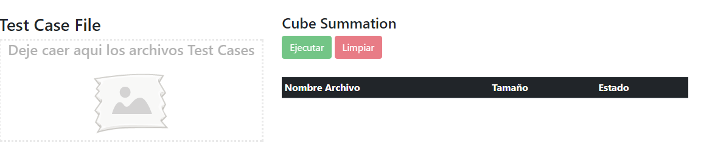
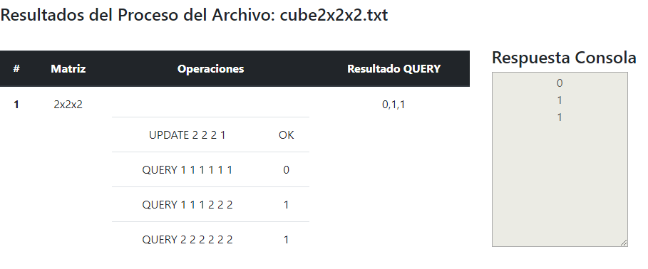
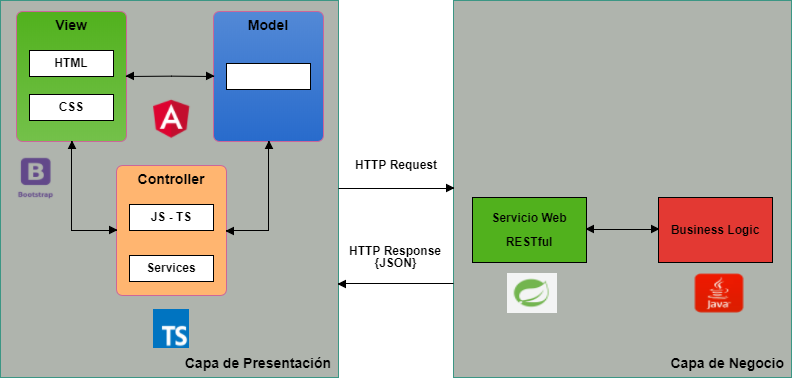

# Coding challenge: Cube Summation

* **[Problem](#problem)**
* **[Solution](#solution)**
* **[Layers](#layers)**
* **[Classes](#classes)**
* **[Error codes](#error-codes)**
* **[How to run](#how-to-run)**

# Problem

Solve the HackerRank problem [Cube Summation](https://www.hackerrank.com/challenges/cube-summation/problem).

You are given a 3-D Matrix in which each block contains 0 initially. The first block is defined by the coordinate (1,1,1) and the last block is defined by the coordinate (N,N,N). There are two types of queries.
```
UPDATE x y z W
```
updates the value of block (x,y,z) to W.
```
QUERY x1 y1 z1 x2 y2 z2
```
calculates the sum of the value of blocks whose x coordinate is between x1 and x2 (inclusive), y coordinate between y1 and y2 (inclusive) and z coordinate between z1 and z2 (inclusive).

<strong>Input Format</strong>
The first line contains an integer T, the number of test-cases. T testcases follow.
For each test case, the first line will contain two integers N and M separated by a single space.
N defines the N * N * N matrix.
M defines the number of operations.
The next M lines will contain either
```
 1. UPDATE x y z W
 2. QUERY  x1 y1 z1 x2 y2 z2
```
<strong>Output Format</strong>
Print the result for each QUERY.

#### Sample Input
```
2
4 5
UPDATE 2 2 2 4
QUERY 1 1 1 3 3 3
UPDATE 1 1 1 23
QUERY 2 2 2 4 4 4
QUERY 1 1 1 3 3 3
2 4
UPDATE 2 2 2 1
QUERY 1 1 1 1 1 1
QUERY 1 1 1 2 2 2
QUERY 2 2 2 2 2 2
```
#### Sample Output
```
4
4
27
0
1
1
```
This sample is also a unit test: `CubeServiceImplTest.sampleInputGivesSampleOutput`.

# Solution

* An Angular component gets a plain text file by drag and drop.
* The front sends the file with an HTTP POST to the Spring REST API.
* The API reads the file, runs the test cases, and returns the results as JSON.
* The input is a plain text file in the HackerRank format above. Blank lines are ignored.



* The output is a table with the result of each operation, and a console with the output of the QUERY operations.



# Layers



# Classes

### Front (cube-front)

* **cargar-archivo.component.html** - view that loads the file and shows the results.
* **cargar-archivo.component.ts** - component that calls the service and keeps the results.
* **send-file.service.ts** - sends the file with HTTP POST and returns an Observable.

### API (cube-summation)

#### CubeController

Exposes `POST /cube/upload`. It only handles HTTP: it gives the file to `CubeFileParser`
and the test cases to `CubeService`.

  + **HTTP method:** POST
  + **URI:** `http://localhost:9999/cube/upload`
  + **Content-Type:** `multipart/form-data`, with the text file in the `file` field

Response body:
```json
{
    "lstCases": [
        {
            "matrixN": 2,
            "operations": [
                { "operation": "UPDATE 2 2 2 1", "result": "OK", "status": 200, "type": "UPDATE" },
                { "operation": "QUERY 1 1 1 1 1 1", "result": "0", "status": 200, "type": "QUERY" },
                { "operation": "QUERY 1 1 1 2 2 2", "result": "1", "status": 200, "type": "QUERY" },
                { "operation": "QUERY 2 2 2 2 2 2", "result": "1", "status": 200, "type": "QUERY" }
            ],
            "result": [0, 1, 1],
            "status": 200
        }
    ],
    "lstResults": [0, 1, 1],
    "msg": "El archivo ha sido procesado exitosamente.",
    "status": 200
}
```

#### CubeFileParser

Reads the uploaded text into a `CubeTestCasesDTO`. It checks the file format, but it does not run the operations.

#### CubeService / CubeServiceImpl

Runs the operations of each test case with `ContextCubeStrategy` and collects the QUERY results.

#### ContextCubeStrategy

Picks the strategy for each operation by its first word. Spring gives it all `CubeStrategy` beans.
It has no mutable state, so it is safe to share between requests.

#### CubeStrategy, UpdateCubeStrategy, QueryCubeStrategy

`CubeStrategy` is the common interface. Each strategy says which operation it handles with `type()`.
To add an operation, add a value to `ETypeOperation` and a new `CubeStrategy` bean. No other class changes.

#### OperationDTO, CubeDTO, CubeTestCasesDTO

Plain data objects: one operation, one test case (the 3-D matrix and its operations), and all test cases.

#### CubeControllerAdvice

Turns errors into a response body with `status` and `msg`. The HTTP status is always 200,
because the bundled front shows "service unavailable" for any other HTTP status.

#### LogExecutionAspect

Logs the start, the end, and the time of each method marked with `@LogExecutionTime`.

# Error codes

When something fails, the body has `status` different from 200 and a message in `msg`.

| Code | Meaning |
|------|---------|
| 310 | The operation is not UPDATE or QUERY. |
| 311 | N (matrix size) is not a valid number. |
| 312 | UPDATE does not have 5 parts. |
| 313 | QUERY does not have 7 parts. |
| 314 / 315 | UPDATE or QUERY was expected. |
| 316 | M (number of operations) is missing or not valid. |
| 317 | T (number of test cases) is not valid. |
| 318 | A value in an operation is not a whole number. |
| 319 | The file is empty. |
| 320 | The file has fewer lines than T and M say. |
| 321 | A coordinate is lower than 1. |
| 500 | Unexpected error. |

# How to run

The API uses port 9999. The bundled front uses the base path `/CS/`.

### Cube-Summation (API)

* Spring Boot 1.5.9 and Java 8. You need Maven 3.
* Run the tests: `mvn test` in the `cube-summation` folder.
* Run the API only: `mvn spring-boot:run`. The API is at `http://localhost:9999/cube/upload`.
* Run the API with the bundled front: `mvn package`, then
  `java -jar target/CS.war --server.context-path=/CS`. Open `http://localhost:9999/CS/`.
* You can also deploy `target/CS.war` to Tomcat. Use port 9999, because the built front calls that port.
  It was tested on Tomcat 9.

### Cube-Front (source of the front)

* Angular project made with Angular CLI 1.6.3. It needs Node.js 6.9.0 or newer.
* Install Angular CLI: `npm install -g @angular/cli`.
* Run `npm install`, then `ng serve -o` in the `cube-front` folder.
  In development mode the front calls the API at `http://localhost:9999/`.
